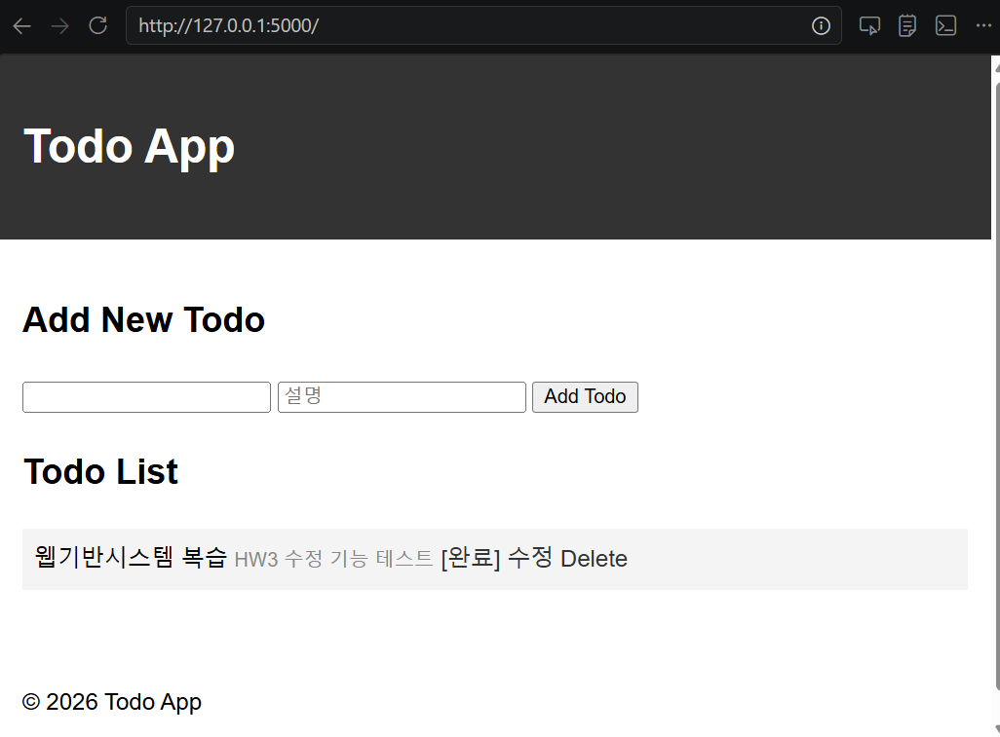
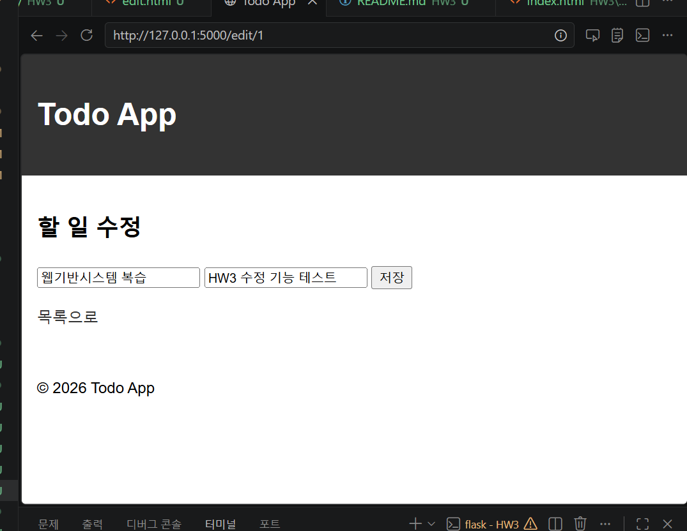
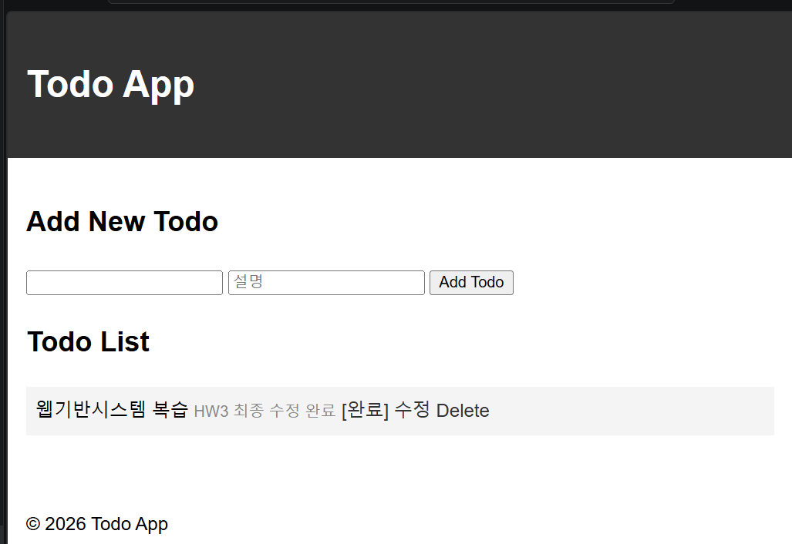

HW3 - Todo 앱 수정 기능 추가

1. 과제 소개

Flask와 SQLAlchemy를 사용하여 데이터베이스 기반 Todo 앱을 구현하고, 기존 할 일과 설명을 수정하는 기능을 추가했습니다.

2. 구현 기능

할 일과 설명 추가

할 일 목록 조회

완료 상태 변경

할 일 삭제

할 일과 설명 수정(Edit)

## 3. 실행 화면

### ① 할 일 목록 화면

### ② 할 일 수정 화면

### ③ 수정 후 목록 화면

